<p align="center">
  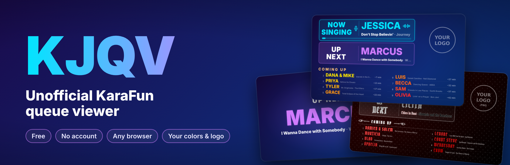
</p>

<p align="center">
  <a href="https://kjqv.github.io/"></a>
  <a href="https://kjqv.github.io/?demo"></a>
  <a href="https://ko-fi.com/4kjqv"></a>
</p>

<p align="center">
  A free webpage that turns any device with a browser into a live KaraFun queue display.<br>
  Now Singing, Up Next and the line, updating instantly as you run your night, in your own colors with your own logo.<br>
  No account, no install.
</p>

<p align="center"><sub><i>An independent project by a fellow KJ. Unofficial; not made by or affiliated with KaraFun. KaraFun is a trademark of its owner.</i></sub></p>

**Open it:** https://kjqv.github.io/ · **Preview:** https://kjqv.github.io/?demo shows a made-up sample queue (your real queue needs KaraFun with remote control on). It runs on any smart TV with a browser, or any device with a browser hooked up to a screen: a Fire Stick (Silk), a laptop on HDMI, a tablet, a Raspberry Pi, and so on.

| The default look (add your logo) | Or a theme |
|---|---|
| 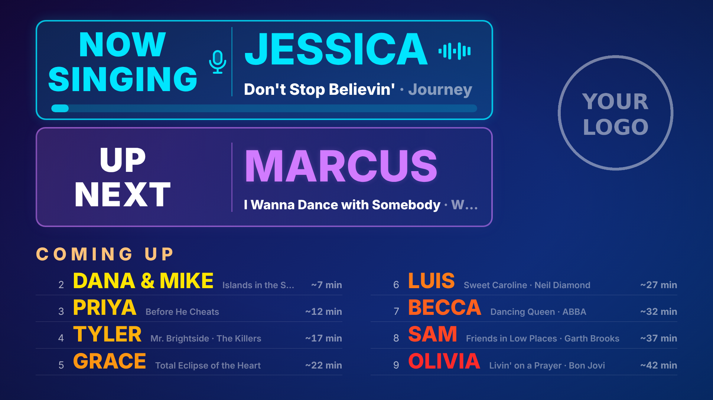 | 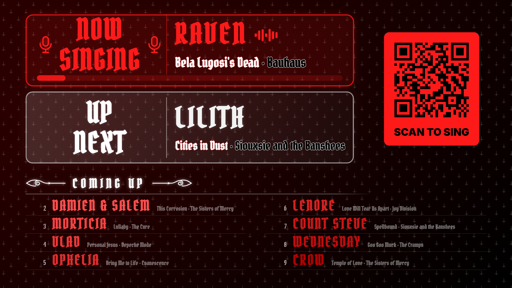 |
| **Spotlight** (on by default) | **When nobody's signed up** |
|  | 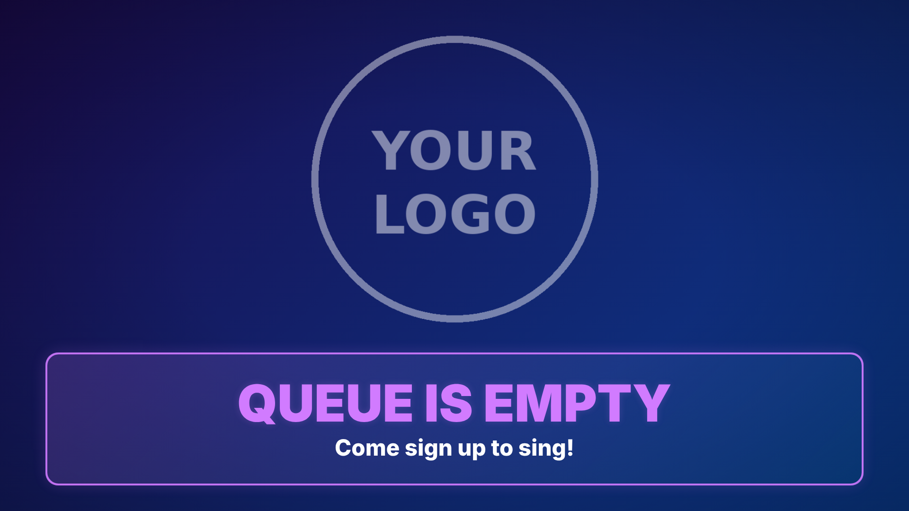 |

## What it shows

- **Now Singing:** the current singer and song, with time left.
- **Up Next:** the next singer, big, so they know to get ready. Before you press play, the singer whose song is loaded shows here.
- **Coming Up:** the rest of the line, with a rough wait time for each person. If nobody else is waiting, it says **QUEUE IS EMPTY · Come sign up!**
- **An empty queue:** your logo big in the middle with **QUEUE IS EMPTY · Come sign up to sing!** under it, so the screen still works for you when the night is slow.

**Optional extras:**

- **Spotlight mode** (on by default; `spotlight=off` to turn it off): the screen wipes over to a big full-screen card: **NOW SINGING** while a song plays, **UP NEXT** near the end and between songs, switching back and forth with the normal screen. [See it in goth](https://kjqv.github.io/goth).
- **Scan-to-sing QR code** (`qr=on`) so guests can join your KaraFun session and add songs. Use it in place of your logo, flip between your logo and the QR code like a coin every 5 seconds (`qr=split`), or show both, small (`qr=both`).
- **Applause mode** (`applause=on`): a big "MAKE SOME NOISE FOR (name)!!!" when each singer finishes.
- **[Equity mode](#equity-mode)** (`equity=on`, *experimental*, off by default): spaces out repeat singers so everyone gets a turn. This changes your actual KaraFun queue: it reorders songs.
- **Planned breaks and announcements:** queue `BRB KJ 15`, `DANCE 10` or `LAST CALL` as a singer name and the screen shows a countdown, a DANCE PARTY or a flashing LAST CALL. Nothing to turn on.
- **Idle screen** (`idle=5`): *paused for now while I rework it.* The setting is ignored, so the screen always shows the full queue.

**Built to run all night, hands-off:**

- **An on-screen Options menu:** pick a theme, colors and your logo, and turn features on or off, with a TV remote or a tap. See [Make it your own](#make-it-your-own).
- **Updates itself:** when a new version comes out, the screen picks it up by itself at the next gap between songs. Nothing to reinstall or reload.
- **Stays awake** where the device allows it, and the mouse pointer hides after a minute.
- **Reconnects by itself** if the Wi-Fi drops or KaraFun restarts.

It follows KaraFun exactly: skip, reorder or delete in KaraFun and the screen updates instantly. A song queued with no singer name shows the artist in the big slot instead. Colors, counts, timings and the rest are all adjustable (see [Make it your own](#make-it-your-own)).

KaraFun doesn't share the playback position, so the time-left countdown starts when you press play and follows pauses. If you open the page in the middle of a song on a new device, it shows the song's length until the next song starts. In the last 20 seconds of a song, the Up Next box glows so the next singer heads up (and with `time=both`, the countdown flashes too).

## About your KaraFun code

The first time you open the page, it asks for the 6-digit **remote control code** that KaraFun already shows your guests (it's in the QR code they scan to add songs) and connects to your session with it.

- The code is saved only in that device's browser. It only appears on the screen if you turn on `qr=on`, which shows the same join QR code KaraFun gives your guests.
- There's no account, no sign-up, no ads, no tracking, and no server of mine collecting anything. The whole app is one web page.
- The page talks directly to KaraFun. The only other things it loads are your logo (from wherever you host it), a Google Font if you pick one, its own page from GitHub to check for updates, and, only if you turn on weather, [Open-Meteo](https://open-meteo.com) (free, no account) with your ZIP code's location.
- By default it only **reads** the queue and never changes it: it doesn't add, remove or reorder songs, and it can't touch your KaraFun account or billing. The exceptions, all off unless you turn them on, are [Equity mode](#equity-mode) (experimental), which moves songs around to space out repeat singers, and the experimental [KJ mode](#kj-mode) controls on your phone. It shows up as **KJQV** in KaraFun's list of connected guests.
- It's open source: everything is in one file, [index.html](index.html), that anyone can read.

## What you need

- A [KaraFun subscription](https://www.karafun.com/subscribe.html) *(KaraFun's site; KJQV is not affiliated with KaraFun)* with **Remote control** (it's in Settings on iPad/iPhone, or the remote icon above the player on Mac/Windows).
- **[KaraFun Pro](https://www.karafun.com/pro/) is recommended.** *(KaraFun's site; not affiliated.)* Pro lets your remote control code stay the same every session, but **it's off by default**: turn on the fixed (permanent) code in KaraFun's remote control settings. Then you set the screen up once and your bookmark keeps working. On other plans the code changes each session, so you'd enter the new code on the screen every time (press select → **Change code**). Pro is also KaraFun's plan for public venues: it includes the commercial license you need to run karaoke at a bar or event.
- Any device or display with a web browser: a smart TV, a Fire Stick, a laptop or Raspberry Pi on HDMI, a tablet.

## Setup

1. In KaraFun, turn on **Remote control** and note the 6-digit code. To show singer names, turn on **Ask options** in KaraFun's queue settings.
2. Open https://kjqv.github.io/ in the browser on the device driving your screen.
3. Enter your code on the on-screen number pad. A Fire TV remote's arrows and select button work.

The code is saved on that device, so next time you just open the page. You can also bookmark it with your code built in: `?code=123456`.

To open the small menu (**Full screen**, **Options**, **Change code**), tap or click the screen, or press any arrow or select/Enter on a TV remote or keyboard. It closes by itself after 10 seconds, so nothing gets in the way of the queue.

## KJ mode: your phone as a KJ remote <i>(experimental)</i>
<a id="kj-mode"></a>

Open your usual link on your phone with `&kj=on` added (or `&kj=on&kjcontrols=on` for the controls). Instead of the TV screen you get an upright page just for you, the KJ. Try it with the made-up demo queue: **[kjqv.github.io/?demo&kj=on&kjcontrols=on](https://kjqv.github.io/?demo&kj=on&kjcontrols=on)**

| The queue | Tap a singer | Change song | History |
|---|---|---|---|
| 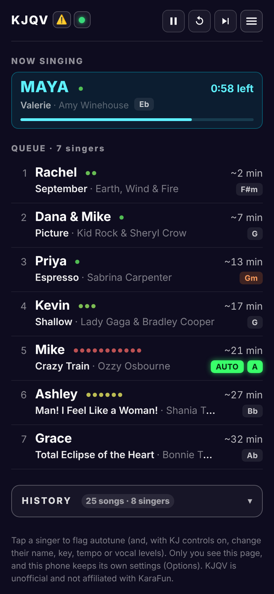 | 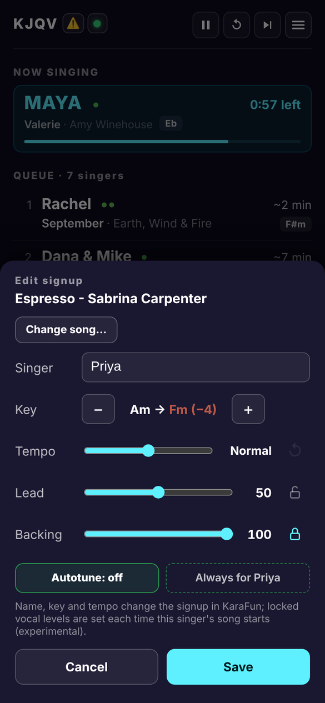 | 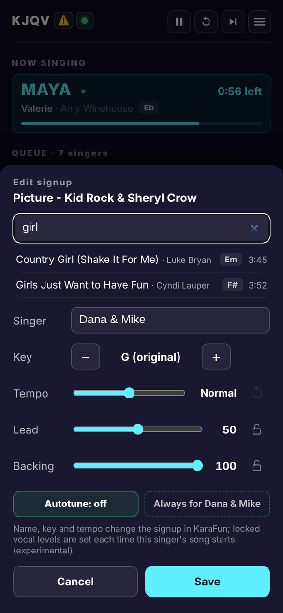 | 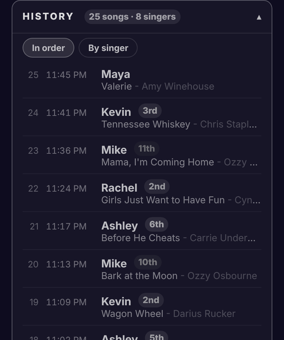 |

**What you see**
- **Now singing** with a progress bar and the time left (the name flashes in the last 10% of the song), then the whole queue with roughly when each person is up.
- **Keys** from KaraFun on every signup. A moved key shows just the new key, colored by how far it moved: orange getting redder the further down, pink getting more violet the further up. Set *KJ view: show keys as* in Options (`keys=sharp` or `keys=flat`) to match your gear.
- **Queue size** (Options → *KJ view: queue size*): **Compact** by default (about 10 or more on screen), **Tiny** (one line per signup) or **Roomy** (bigger text).
- **Song counts:** a row of small dots by each name, one per song tonight, from green through yellow to red, so you know when someone's had plenty of turns.
- **History** at the bottom: tonight's songs in order, or **By singer**. It's kept on your phone and resets at 6am. Restarts don't count as new songs. **Duets** (*Bonny + Russell*, *Bonny/Russell*, *Bonny & Russell*) show as *Bonny & Russell* everywhere (on the TV too). With the controls on, KJ mode also renames the signup in KaraFun itself, so KaraFun's own screen and remote match (never the song that's playing, and it shows in the Action log), and count for each person: if Russell sings 5 duets and 2 solos, his count is 7 and every song is under his name in *By singer* (with who he sang it with).
- An *EXPLICIT* tag on songs KaraFun marks explicit, and a green **AUTO** tag for singers flagged for autotune.

**Swipe a signup left** to remove it. **Tap a singer** to:
- Flag them for **autotune** (just this song, or *Always for …*; you can also list names in Options → **Singers**). Duets get one *Always* button per person, and a duet gets autotune if anyone in it is set to always.
- Change their **name** (not while they're singing), **key** (up to 6 steps either way) and **tempo** (−50% to +50%).
- **Change song…**: search KaraFun's catalog and swap a different song into their spot in line.
- **Remove** them: swipe a signup left (like an iPhone list) and tap the red **Remove**, then **Remove?** to confirm. Or tap it and use **Remove** on the edit screen.
- Set their **lead and backing vocal** levels. Tap the lock to keep them for the night; they're set again each time their song starts.

**Logging out of a code** (home and the bar, say): tap the connection dot, then **Log out** (next to the name it joined as). KJQV forgets that code and asks for a new 6-digit one. KJ mode reconnects, and the address changes to the new code, so a home-screen icon or bookmark you open from that page afterwards uses it.

**BPM** (off by default: Options → *KJ view: BPM next to the key*, or `bpm=on`): each song's tempo in beats per minute, just left of its key. KaraFun doesn't share BPM, so KJ mode looks each song up by title and artist on Deezer's free public music API and remembers it on your phone; a tempo change in KaraFun adjusts the number (orange slower, pink faster). Songs Deezer doesn't know show no BPM.

**Signups from the sheet** (Options → *KJ view: signup sheet*). Tap the signup-sheet (clipboard) button at the top. By default it's free and needs no key: in **Photos**, press and hold on the sheet's writing, tap **Copy All** (iPhone Live Text), paste it into KJQV (one signup per line works best: *Name – Song – Artist*) and tap **Find the songs**. Live Text can't see cross-outs, so untick anyone who's done. Or set the option to **Photo read by Claude**: take a photo of your paper signup sheet (or pick one you already took), and Claude reads each singer, song and artist (and the cross-outs), finds the songs in KaraFun, and shows you the list to check. When a song isn't an exact match it shows a % guess (*Dead or Alive · Bon Jovi* → *Wanted Dead or Alive*, 96%): a clear best guess (80%+) is picked for you in yellow, anything less waits for you to choose from KaraFun's closest songs or search. Lines crossed off on the left, already in the queue, or already sung tonight (History) are skipped and folded away, and new signups show 5 at a time. Untick anything you don't want and tap **Add**. Lines that don't get added (not in KaraFun, or left unticked) go on a **Not added from photos** list under History for the night, and anything KaraFun doesn't have gets a **▶ YouTube karaoke** search link, and they join the end of the queue in sheet order. Reading handwriting uses Claude with **your own Anthropic API key** (about a cent per photo, billed to you). KJ mode asks for it the first time (or tap the 🔑 next to ⚠️ to add, change or forget it; it turns green once one is saved), keeps it only on that phone, never puts it in a link, and only ever sends it to Anthropic, so sharing your KJQV link never shares your key. The demo shows the whole flow with a made-up sheet and no key.

**Rearrange the queue:** with the controls on, press and hold a signup to pick it up, drag it to its new spot, and KJ mode asks *Move Rachel · September from #1 to #4?* Tap **Move** (or **Cancel**). Only that signup moves, and nothing changes in KaraFun until you confirm.

**Action log** (tiny, under History): how the night is running, so you can check in from the patio. It shows everything that happens in KaraFun, whoever did it (songs starting, pauses and resumes, new and removed signups, key and tempo changes), plus everything you do in KJ mode (moves, edits, song swaps, skips, restarts). A photo add writes a 📋 line for the sheet, then one 📋 line per signup: Added (with what was written when it wasn't an exact match), Not added and why, or Skipped and why. Anything KaraFun refuses shows in red. Kept on that phone until 6am.

**Quick actions** (⚡ next to the title, with the controls on): type what you want instead of tapping around. *make Ember next*, *move Ember to 3*, *Ember up 2*, *remove Ember*, *skip*, *pause*, *play*, *restart*, *Priya key down 2*, *Priya key original*, *Priya tempo +10*, *autotune Mike*. Add a new signup without leaving KJ mode: *add Ember singing Goodbye Earl by the Chicks up next* or *Ember wants to sing Goodbye Earl the Chicks next* (or *at 3*, or nothing for the end) looks the song up in KaraFun's catalog, shows the best match plus a few others to pick from, and adds it when you tap **Do it**. No typing needed: tap a singer's name chip, then an action chip (**next**, **last**, **remove**, **key −1**, **key +1**, or **skip**/**pause**/**play**/**restart** with no name). It shows what it's about to do (*Move Ember · Dancing Queen to next (from #4)*) and waits for **Do it**. Names match loosely (first name, part of a name, or the song). To say it instead, use your keyboard's own dictation 🎤.

**Controls** (off by default: Options → *KJ view: play, skip and restart*, or `kjcontrols=on`): play/pause, restart and skip at the top. Play is one tap; pause, restart and skip need a second tap so a bump doesn't stop the show. KaraFun's remote has no real restart, so restart adds a copy of the song right after the current one and skips to it.

**Heads up: the controls change your real KaraFun queue.** They only work if KaraFun allows it. KJ mode joins KaraFun as **KJQV KJ** (the TV is plain **KJQV**); tap the dot next to the title (green = connected, blinking red = not) to see its exact name, and make that participant an admin in KaraFun (see [Queue control](#queue-control)). KaraFun may treat KJ mode as a new participant after the page reloads (including when KJQV updates itself), so if the controls stop working, check the name and make it an admin again. Tap ⚠️ for a reminder of what's experimental, and ☰ for Options. Each device keeps its own settings.

**Photos on the KaraFun screen: not possible.** KaraFun only accepts photos sent from its own web remote page (guests tap 📷 there), and KaraFun decides how big they show and for how long. It won't take them from other sites like KJQV, so KJ mode can't send photos to the screen. (The signup-sheet photo above is only read for names; it never goes on screen.)

<details>
<summary><b>HeadRush VX5 key presets <i>(experimental, off by default)</i></b></summary>

The VX5 can't be told a key over USB, but since firmware 1.3 a computer can switch its presets. So save one preset per key, and KJ mode loads the right one when each song starts, or when you change the key of the song that's on. With `vx5=100` (Options → *KJ view: VX5 key presets*), the presets are:

| Presets | Key |
|---|---|
| 100–111 | C, C#, D, D#, E, F, F#, G, G#, A, A#, B (major) |
| 112–123 | Cm, C#m, Dm, D#m, Em, Fm, F#m, Gm, G#m, Am, A#m, Bm (minor) |
| 124 | Chromatic (for songs KaraFun has no key for) |

`vx5=1` uses presets 1–25 instead. Make one preset that sounds right, copy it to each slot with the VX5's copy feature, and change only the key on each copy. Set *KJ view: show keys as* to *Sharps only* so KJ mode matches the VX5's screen. This needs KJ mode open in **Chrome or Edge on a computer** with the VX5 plugged into it by USB (browsers on iPhone and iPad can't talk to MIDI gear); the browser asks once to allow MIDI. The connection dot's details show *VX5: preset 116 (Em)*, or what's wrong.

</details>

## Make it your own

**The easy way: the Options menu.** On the code screen, press **Customize the look**. Or, once your queue is showing, tap the screen (or press an arrow on a TV remote) and choose **Options**. Pick a theme, colors, font, pattern and your logo, set the spotlight timing, turn features on or off, and press **Save**. The **Text** tab lets you change the wording, like the labels, the applause line and the empty-queue message. Nearly every setting is in there. Your choices are remembered on that device. The menu only appears when you open it, so guests never see it.

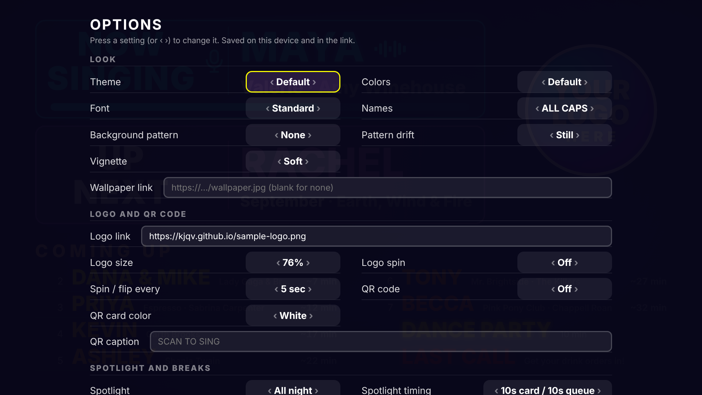

**Or add them to the page address.** Everything in the Options menu (plus a few extras, like any Google Font or your own QR link) can also be set by adding it to the end of the web address, separated by `&`. Like this: `https://kjqv.github.io/?code=123456&theme=goth`. That's handy for bookmarking an exact setup, or for setting up several screens the same way. You never have to do this, but it's there if you want it.

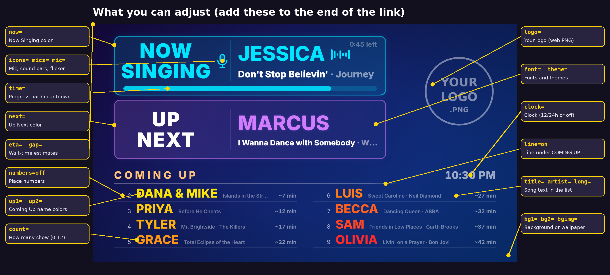

Tip: try any of these on the sample queue first, like `https://kjqv.github.io/?demo&theme=goth`. The preview doesn't save anything.

Anything you don't set uses the defaults: no logo, a deep purple-to-blue background with softly darkened edges, green Now Singing, violet Up Next, and yellow-to-red Coming Up names.

<details>
<summary><b>Every setting you can add to the address (tap to open)</b></summary>

| Option | What it does | Example |
|---|---|---|
| `code` | Your KaraFun remote control code | `code=123456` |
| `logo` | A direct link to your logo image. A transparent PNG looks best | `logo=https://i.imgur.com/abc123.png` |
| `spottime` | Spotlight timing: seconds of the card, then seconds of the normal screen (default `10-10`) | `spottime=8-20` |
| `lite` | Simple GFX mode for old Fire Sticks and other slow devices: no glows, blurs or decorative animation. Automatic on the original Fire TV Stick and first Fire TV boxes; `on` forces it anywhere, `off` turns it off | `lite=on` |
| `wipe` | How the spotlight card comes in: `down` (default), `up`, `left`, `right`, `doors`, `iris` (circle), `diamond`, `fade`, or `random` for a different one each time | `wipe=iris` |
| `spin` | `on` makes your logo spin like a coin every 5 seconds (`qrswap=10` for every 10) | `spin=on` |
| `logosize` | Logo size in percent, 40 to 100 (default 76, which leaves room between it and the boxes) | `logosize=100` |
| `vignette` | How much the edges of the background darken, 1 to 100 (default 30; `on` is 60, `off` removes it) | `vignette=off` |
| `flicker` | The Now Singing name flickers a little, like old neon (on by default); `off` keeps it steady | `flicker=off` |
| `bg1`, `bg2` | Background fade colors, top-left to bottom-right | `bg1=0b3d2e&bg2=1f7a5a` |
| `up1`, `up2` | Coming Up name colors, from next in line to last | `up1=00e5ff&up2=0055ff` |
| `now` | Now Singing color (default green) | `now=00e5ff` |
| `next` | Up Next color (default violet) | `next=fcff00` |
| `count` | How many people show in Coming Up, 0 to 12 (default 8). `0` hides Coming Up | `count=6` |
| `icons` | `icons=off` hides the mic and sound bars next to the current singer | `icons=off` |
| `pulse` | `pulse=off` stops the Now Singing box from pulsing | `pulse=off` |
| `font` | `rounded`, `retro`, `marker`, `pixel` (arcade pixel font with an RGB split), or the name of any [Google Font](https://fonts.google.com) | `font=pixel` or `font=Lobster` |
| `time` | Time left on the current song: `bar` (default, progress bar only), `both` (bar plus a small countdown that flashes in the last 20 seconds), `text` or `off` | `time=both` |
| `clock` | Clock next to COMING UP. Follows the device's region (12- or 24-hour) unless you set `12` or `24`; `off` hides it | `clock=24` |
| `eta` | Shows a calculated estimate of how long until each Coming Up singer is up (like "~12 min"), based on KaraFun's song lengths plus the `gap` between singers. On by default for Coming Up; `on` also shows it next to UP NEXT; `time` shows estimated clock times ("~11:48"); `off` hides them | `eta=on` or `eta=off` |
| `gap` | Seconds to allow between singers for the estimates (default 60) | `gap=90` |
| `long` | Song lines too long to fit: `alternate` (default, title and artist take turns), `top` (slides sideways in Now Singing and Up Next, takes turns in Coming Up) or `scroll` (slides sideways everywhere) | `long=scroll` |
| `caps` | Singer names in capitals (on by default); `off` shows names as typed | `caps=off` |
| `numbers` | `off` hides the place numbers in Coming Up | `numbers=off` |
| `line` | The line under COMING UP, all the way across (on by default). `off` hides it | `line=off` |
| `weather` | A US ZIP code: shows the local temperature (°F) and a little weather icon next to the clock, updated every 15 minutes. TV screen only | `weather=28714` |
| `bgimg` | A wallpaper behind everything: a direct link to a PNG or JPG (darkened a little so names stay readable) | `bgimg=https://i.imgur.com/abc123.jpg` |
| `pattern` | A faint tiled pattern over the background: `crosses`, `petrine` (black upside-down crosses), `tinycrosses` (tiny upside-down crosses), `mics`, `notes`, `trees` (little Christmas tree outlines) or `houndstooth` | `pattern=notes` |
| `scroll` | `on` makes the background pattern drift upward forever (`down` for downward; on by default in goth, `off` to stop it) | `scroll=on` |
| `drip` | `on` adds blood dripping from the top of the QR card and from SCAN TO SING | `drip=on` |
| `mic` | `flicker` makes the Now Singing mic flicker like a dying candle, in your Now Singing color; `off` hides the mic next to NOW SINGING | `mic=flicker` |
| `mics` | `2` puts a mic on both sides of NOW SINGING | `mics=2` |
| `flourish` | `on` makes COMING UP stark white with a soft glow and a curl on each side (on by default in goth) | `flourish=on` |
| `nextflicker` | `on` makes the UP NEXT label flicker like a failing neon sign | `nextflicker=on` |
| `excited` | `on` for enthusiastic mode: NOW SINGING! | `excited=on` |
| `dots` | `on` adds "…" after UP NEXT | `dots=on` |
| `upin` | `on` turns the UP NEXT label into a live countdown, like UP IN 3 MIN (it says UP NEXT again in the last minute) | `upin=on` |
| `align` | `left` or `right` lines up the NOW SINGING and UP NEXT labels on that side of their column instead of centering them | `align=right` |
| `vu` | `swap` puts the VU bars next to NOW SINGING and the mic next to the singer's name; `off` hides the VU bars | `vu=swap` |
| `portrait` | `on` for a screen mounted upright. Without it, a phone held upright shows the TV-shaped screen with a note to turn the phone sideways | `portrait=on` |
| `nowtext`, `nexttext`, `comingtext` | Your own wording for the NOW SINGING, UP NEXT and COMING UP labels (up to 20 characters). Also in the **Text** tab of Options, with all the others below | `nowtext=ON THE MIC` |
| `noisetext`, `thankstext`, `thankssub` | Applause wording: the line before the name, the thank-you before the name, and the line under it. By default each rotates through a mix (*Make some noise for*, *Give it up for*, *Put your hands together for*…). Your own can be several, split with `|` | `noisetext=Give it up for` |
| `emptytext`, `signuptext` | Empty-queue wording (*Queue is empty* / *Come sign up to sing!*) | `signuptext=Grab the book!` |
| `lastcalltext`, `musictext`, `backtext` | The line under LAST CALL, the MUSIC BREAK title, and the line under music breaks and dance parties (*Karaoke's back soon*) | `backtext=Back at 10!` |
| `qr` | `on` puts a QR code where the logo goes (or replaces it) so guests can scan it to join your KaraFun session and add songs. It opens the same link as KaraFun's own QR code. Or give it your own link (a sign-up form, say). `split` flips between your logo and the QR code like a coin (every 5 seconds; `qrswap=10` for 10). `both` shows your logo small on top with the QR code under it. `qrbg` sets the card color behind the code (default white; keep it light so it still scans). `qrtext` changes the caption (default SCAN TO SING). When the queue is empty, the QR code (or your logo and the QR code, flipping) fills the middle of the screen with *Scan the code to sign up!* under QUEUE IS EMPTY | `qr=on`, `qr=split` or `qr=both` |
| `theme` | A ready-made look. `goth`: red and black, gothic lettering, tiny white upside-down crosses slowly drifting down, two flickering red mics, a softly glowing UP NEXT label, a glowing COMING UP, a progress bar but no countdown, wait times or clock, and a red QR card if you turn on `qr`. `turkey`: warm browns, amber and gold with maple leaves drifting down 🦃. `holiday`: deep green and red with little tree outlines scrolling by 🎄 (`xmas` and `christmas` work too). Anything else you set overrides the theme | `theme=goth` ([see it](https://kjqv.github.io/goth)), `theme=turkey` or `theme=holiday` |
| `dance` | DANCE PARTY flashes through rainbow colors by default; give it one color to use that instead | `dance=ff2ad4` |
| `title` | `title=off` hides song titles in Coming Up | `title=off` |
| `artist` | `artist=off` hides artist names in Coming Up | `artist=off` |
| `songs` | `songs=off` keeps songs a surprise: only singer names in Up Next and Coming Up (Now Singing shows it 15 seconds into the song; change that with `songreveal=` in seconds, `0` for right away) | `songs=off` |
| `blank` | A singer name to treat as "no name" (shows the artist instead). Separate several with commas | `blank=Guest` |

</details>

### Extra modes

Tap one to read more. Spotlight is on by default and planned breaks work any time; the others are off until you turn them on.

<details open>
<summary><b>Spotlight mode</b></summary>

Keeps the focus on who's singing and who's up next. **On by default** (as `loop`); add `spotlight=off` to turn it off.

- `spotlight=on`: only between songs. When a song ends (after the applause, if that's on), the screen wipes over to a full-screen **UP NEXT** card with the next singer's name, big and glowing. After 10 seconds it wipes back to the normal screen, then back to the card 10 seconds later, back and forth until the next song starts.
- `spotlight=loop` (the default): the card all night, during songs too: 10 seconds of the card, then 10 seconds of the normal screen (change it with **Spotlight timing** in Options, or `spottime=8-20` for 8 seconds of card and 20 of the queue). While a song has more than 30 seconds left, the card shows **NOW SINGING** and the current singer (in the Now Singing color); in the last 30 seconds and between songs it switches to **UP NEXT** (with `upin=on` it says UP IN 3 MIN).
- It skips BRB, DANCE and LAST CALL breaks.
- See everything together in goth: **https://kjqv.github.io/goth**

| While a song plays | Near the end and between songs |
|---|---|
|  | 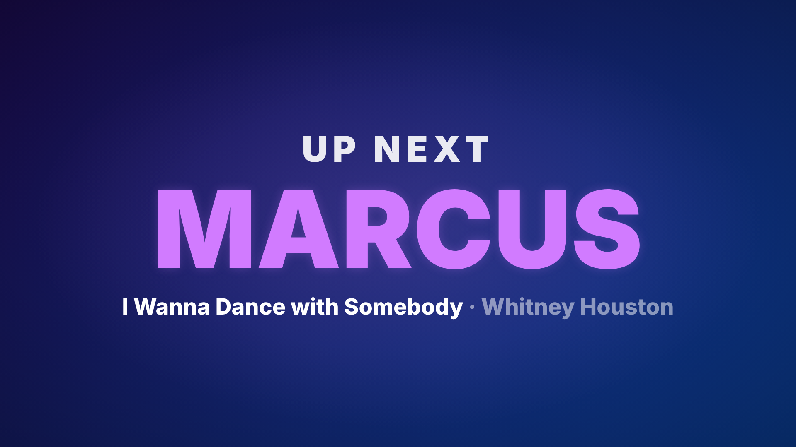 |

</details>

<details>
<summary><b>Applause mode</b></summary>

Off by default. Add `applause=on` and when a singer finishes, the screen shows a big **MAKE SOME NOISE FOR (name)!!!** for 10 seconds (`applause=15` for 15, anywhere from 3 to 60). After that, spotlight takes over (or, with `spotlight=off`, it stays on your logo with Up Next along the bottom until the next song starts). With no logo it says "Thank you, (name)!" instead. It only fires after a song has played for at least 30 seconds, and it skips BRB, Dance Party and other special names.

| When a song ends | Then, until you hit play |
|---|---|
| 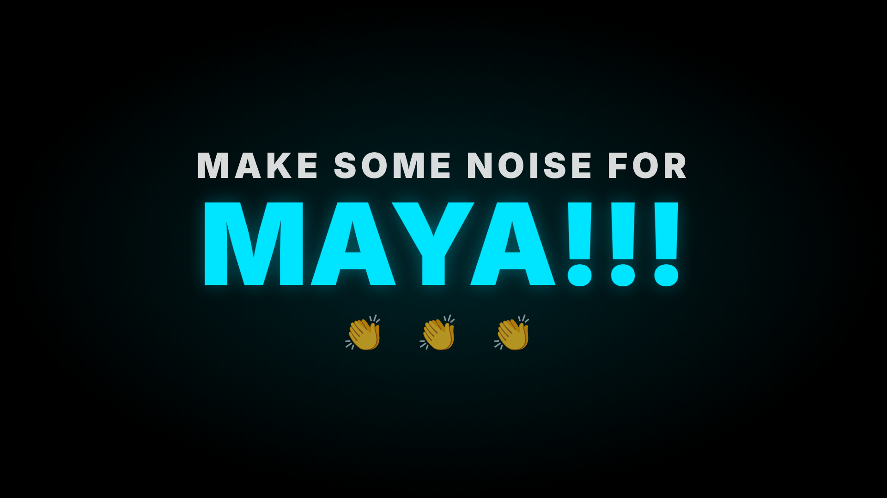 |  |

</details>

<a id="queue-control"></a>
<details>
<summary><b>Queue control <i>(for KJ mode and Equity, experimental)</i></b></summary>

KaraFun only lets a remote change the queue if you allow it. In KaraFun Pro: **Remote Control → Participants**, find **KJQV** (the TV screen) and make it an **admin**. Only do it for KJQV; turning on queue management for everyone under *Permissions* would let any guest move or delete songs. If KaraFun refuses a KJ mode control, a note under the buttons says so with that reminder. If KaraFun refuses, KJQV stops trying. We haven't confirmed yet whether KaraFun keeps the admin grant when the TV reconnects, so check the KJ view after a restart.

</details>

<a id="equity-mode"></a>
<details>
<summary><b>Equity mode <i>(experimental)</i></b></summary>

Off by default. **Heads up: this changes your real KaraFun queue** (the KJ mode controls can too). It moves songs around (it never adds or removes any), and the new order shows up in KaraFun and on everyone's phones. Turn it on in the **Options** menu (Equity), or add `equity=on` to the link, and the screen spaces out repeat singers in KaraFun's queue, keeping at least 3 other singers between someone's songs. Set your own number with `equity=5`, or use `equity=scale` to have the spacing grow with the crowd: about a third of the people in line (5 singers → 1 between repeats, 15 singers → 5).

- Same name = same singer. Give two Susans different names ("Susan B", "Susan K").
- It never moves the song that's on or the one in Up Next.
- Anything you move by hand in KaraFun stays where you put it.
- If there aren't enough other singers, the extra songs go to the end.
- BRB, DANCE and LAST CALL entries never move, and don't count as singers.
- See it on the sample queue: `https://kjqv.github.io/?demo&equity=on`

</details>

<details>
<summary><b>Planned breaks and announcements</b></summary>

Type one of these as the singer name on any song. Don't press play on it; skip it when you're back. The number is minutes (optional), and everyone's wait time after it includes them. When it comes up, the screen switches to the break screen with whoever's after it in Up Next.

| Singer name | What the screen shows |
|---|---|
| `BRB KJ 15` | "15 min break · KJ will be back" in the line (in black letters, so it stands out as a break), then "KJ will be back · in about 15 min". KJ can be any name, BRB can go anywhere in it (`Bowser BRB 5`), or leave the name out (`BRB 10`) |
| `DANCE 10` (or `DANCE! 10`, `Dance Party 10`) | **DANCE PARTY** flashing through rainbow colors (or your `dance=` color), then "Karaoke's back in about 10 min" |
| `LAST CALL` | **LAST CALL** flashing in red, "Get your drink orders in!" |

These are just singer names to KaraFun, so KaraFun's own screen and scrolling queue will still show them as typed ("BRB KJ 15" and so on). Only this screen turns them into breaks and announcements.

</details>

<details>
<summary><b>Idle screen <i>(paused for now)</i></b></summary>

**Paused for now:** `idle=` is ignored while I rework this, so the screen always shows Up Next and Coming Up. The description below is how it worked.

Turn this on with `idle=5` and if KaraFun hasn't played anything for 5 minutes (say you're playing a song from YouTube, or taking a music break), the screen switches to a simpler idle screen: your logo big in the middle (or "Short break" if you haven't set a logo) plus the Up Next box. As soon as you press play, it goes back to normal. It's off by default. Planned breaks (`BRB`, `DANCE`, `LAST CALL`) work either way.

| Option | What it does | Example |
|---|---|---|
| `idle` | Turns on the idle screen after this many minutes without playback (off by default; `on` = 5) | `idle=5` |

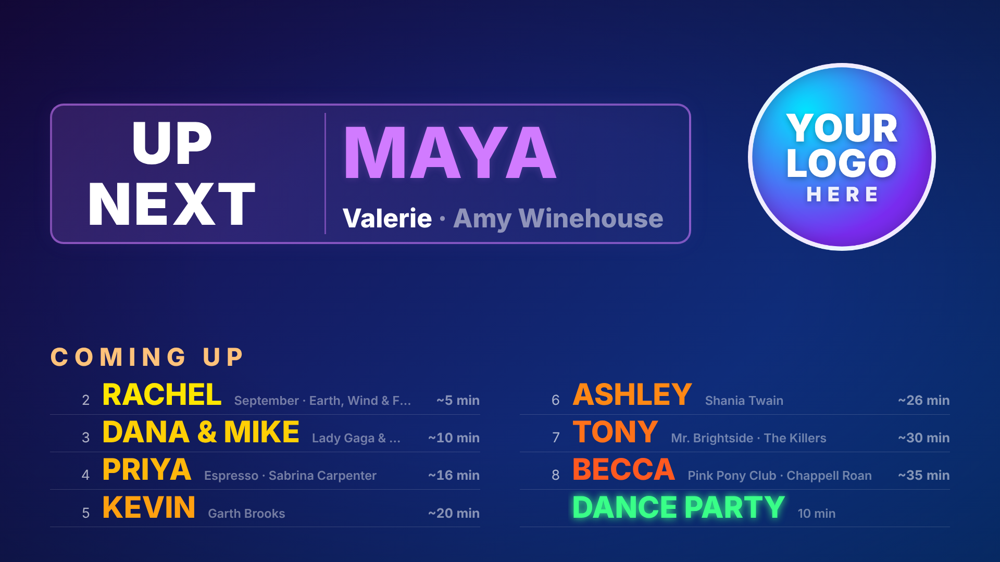

</details>

### Color ideas

Copy any of these onto the end of your link (after your `code=`):

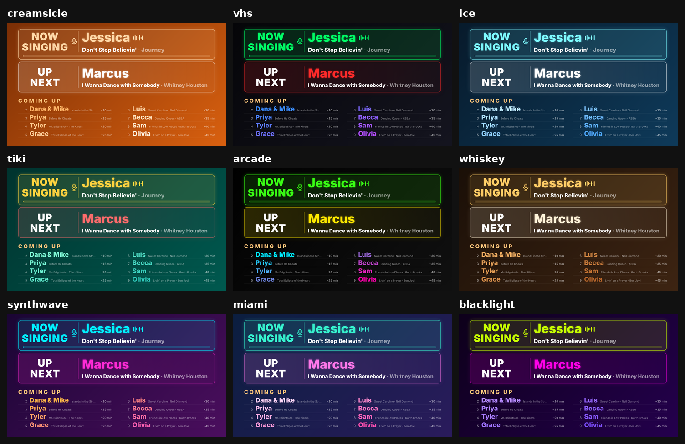

<details>
<summary><b>All color presets (tap to open)</b></summary>

| Look | Add to your link |
|---|---|
| Creamsicle | `&bg1=7a2e05&bg2=d9600f&now=ffd8a8&next=ffffff&up1=ffb366&up2=fff0dc` |
| VHS | `&bg1=050508&bg2=14141f&now=00ff66&next=ff2a2a&up1=3a8bff&up2=b04dff` |
| Arcade | `&bg1=000000&bg2=101010&now=39ff14&next=ffe600&up1=00e5ff&up2=ff00aa` |
| Whiskey | `&bg1=1a0f07&bg2=3d2412&now=ffcc66&next=fff1d6&up1=e8a85f&up2=b5652b` |
| Ice | `&bg1=071a2b&bg2=0e3a5a&now=7df9ff&next=ffffff&up1=bde8ff&up2=4fa8ff` |
| Tiki | `&bg1=00332e&bg2=00594f&now=ffd23f&next=ff6b6b&up1=7cf5d1&up2=2ec4b6` |
| Synthwave | `&bg1=1a0533&bg2=4b0e5e&now=00f0ff&next=ff2ad4&up1=ffb347&up2=ff5fb0` |
| Miami | `&bg1=0b1e3f&bg2=2a1b5c&now=36f1cd&next=ff77e9&up1=ffd3f5&up2=ff4fae` |
| Blacklight | `&bg1=0d001a&bg2=24004d&now=c6ff00&next=ff00e6&up1=b388ff&up2=7c4dff` |

</details>

Colors are hex codes **without** the `#`. On/off options accept `off`, `0` or `no`. A full example:

```
https://kjqv.github.io/?code=123456&logo=https://i.imgur.com/abc123.png&bg1=0b3d2e&bg2=1f7a5a&up1=00e5ff&up2=0055ff
```

### Themes and fonts

| `theme=goth` | `font=pixel` |
|---|---|
| 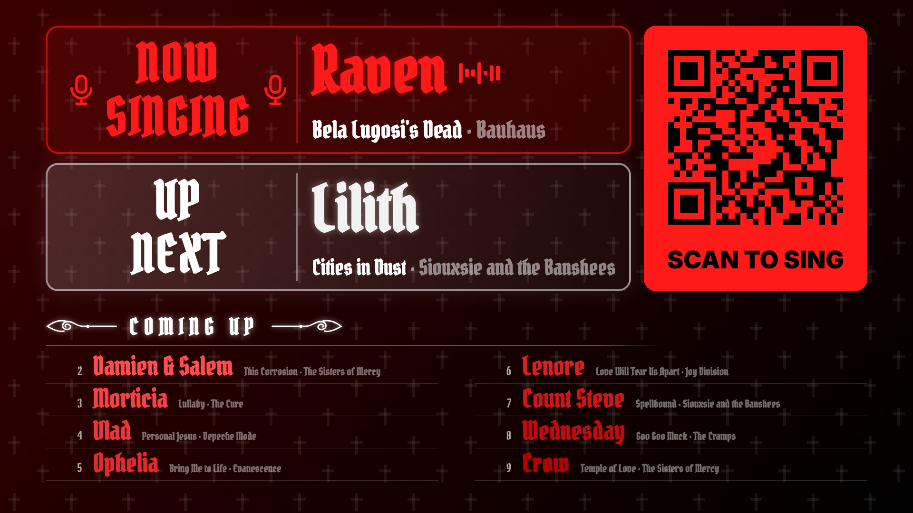 | 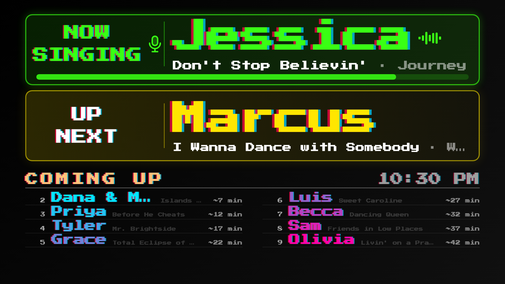 |

### Example looks

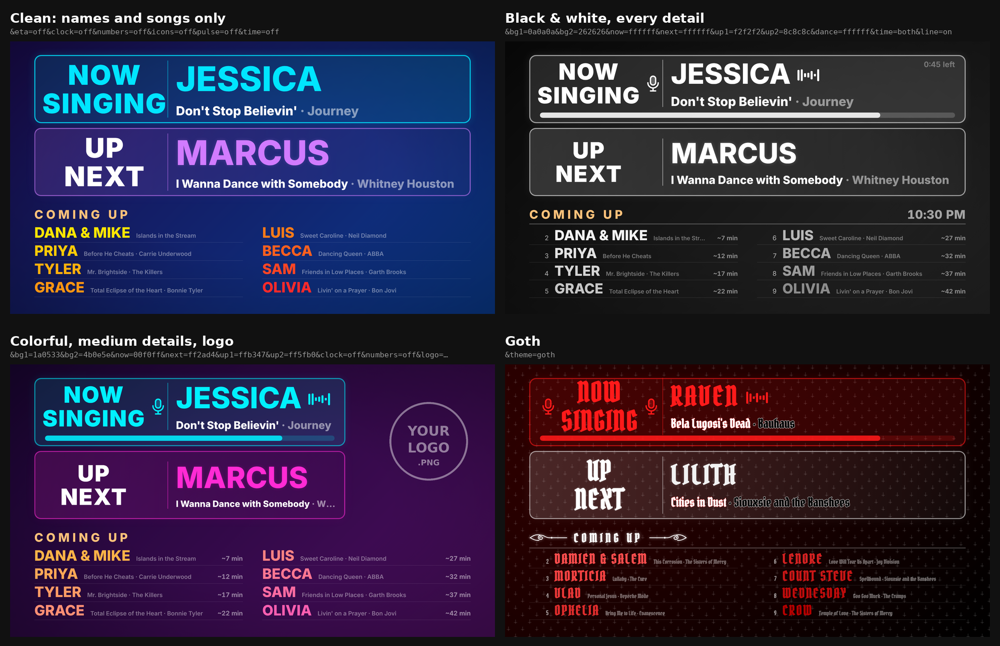

- **Arcade, pixel font:** `&bg1=000000&bg2=101010&now=39ff14&next=ffe600&up1=00e5ff&up2=ff00aa&font=pixel&clock=off`
- **Big names for a far-away TV:** `&count=4&songs=off&bg1=7a2e05&bg2=d9600f&now=ffd8a8&next=ffffff&up1=ffb366&up2=fff0dc&clock=off`
- **Synthwave with scrolling music notes:** `&bg1=1a0533&bg2=4b0e5e&now=00f0ff&next=ff2ad4&up1=ffb347&up2=ff5fb0&pattern=notes&scroll=on&clock=off`
- **Goth:** `&theme=goth`
- **Black & white, names only:** `&bg1=0a0a0a&bg2=262626&now=ffffff&next=ffffff&up1=f2f2f2&up2=8c8c8c&dance=ffffff&songs=off&eta=off&numbers=off&icons=off&line=on`
- **Ice with houndstooth:** `&bg1=071a2b&bg2=0e3a5a&now=7df9ff&next=ffffff&up1=bde8ff&up2=4fa8ff&pattern=houndstooth&clock=off`

### Example setups

Tap **Preview** to see each one on the sample queue. To use one, put the options after your own code: `https://kjqv.github.io/?code=123456` + the options.

| Setup | Try it | Options |
|---|---|---|
| Monochrome, clock on, 5 minutes per singer change | [Preview](https://kjqv.github.io/?demo&bg1=111111&bg2=2e2e2e&now=ffffff&next=ffffff&up1=f0f0f0&up2=8a8a8a&dance=ffffff&icons=off&pulse=off&gap=300) | `&bg1=111111&bg2=2e2e2e&now=ffffff&next=ffffff&up1=f0f0f0&up2=8a8a8a&dance=ffffff&icons=off&pulse=off&gap=300` |
| Names only, no clocks or timers | [Preview](https://kjqv.github.io/?demo&songs=off&time=off&eta=off&clock=off&count=12) | `&songs=off&time=off&eta=off&clock=off&count=12` |
| Big text for a far-away patio TV | [Preview](https://kjqv.github.io/?demo&count=4&songs=off&font=rounded) | `&count=4&songs=off&font=rounded` |
| Retro look, scrolling song titles, 24-hour clock with start times | [Preview](https://kjqv.github.io/?demo&font=retro&long=scroll&clock=24&eta=time) | `&font=retro&long=scroll&clock=24&eta=time` |

### Hosting your logo (and wallpaper)

Any PNG or JPG hosted on the web works: point `logo=` (or `bgimg=`) at the image's own address, usually ending in `.png` or `.jpg`. A transparent PNG looks best for logos.

- **Imgur** is an easy free option: upload while signed in, then right-click the image and copy its address (it starts with `i.imgur.com`).
- If the image doesn't load, that spot just stays empty and the queue still works.
- Want to see how a logo looks first? Try the sample: `logo=https://kjqv.github.io/sample-logo.png` (or a red one for goth: `logo=https://kjqv.github.io/sample-logo-red.png`)

### Tips

- **Settings are remembered on that device.** A link with any options replaces the saved look (it doesn't mix with the old one), and a plain `?code=` link keeps it. Open your full link once, then **bookmark it** so you can get back in one click. Add `?reset` to clear the saved code and settings.
- **Shorten the link** with bit.ly, or with [go.aftvnews.com](https://go.aftvnews.com) *(not affiliated)* for Fire Sticks, to save a lot of typing with a remote.

## More info

<details>
<summary><b>Fire Stick tips (and which Fire Stick to get)</b></summary>

- **Check which Fire Stick you have.** Amazon's newest sticks run **Vega OS** instead of Fire OS: the **Fire TV Stick HD (2nd Gen, 2026)**, anything named **Select**, and the newest plain **Fire TV Stick 4K** (3rd gen). They can't install other apps, and the Silk browser drops back to the home screen after about 10 minutes no matter what the page does. Check under **Settings → My Fire TV → About**: a version that says **Fire OS** is fine; one that starts with **1** or **2** is Vega OS.
- **For an always-on screen, use a Fire OS stick** (a Fire TV Stick 4K Max or 4K Plus is a good pick, and older sticks work too) with **[Fully Kiosk Browser](https://www.fully-kiosk.com)** *(not affiliated)* instead of Silk. Install the **Downloader** app by AFTVnews from the Amazon Appstore, use it to download Fully Kiosk from fully-kiosk.com, set the **Start URL** to your KJQV link, and turn on **Keep Screen On**. That gets around the sleep. On the original Fire TV Stick and the first Fire TV boxes, KJQV switches to **Simple GFX mode** by itself: no glows or decorative animation, so the old hardware keeps up (change it at the bottom of Options, under **Simple GFX mode**).
- **Hide Silk's address bar:** once the page loads, press **down** on the remote.
- **Stop the screensaver:** turn off **Ambient Experience**, or set **Settings → Display & Sounds → Screensaver → Start Time → Never**.
- **Edges cut off?** The TV is cropping the picture. Try **Settings → Display & Sounds → Display → Calibrate Display** on the Fire Stick, or set the TV's picture size to "Just Scan" or "Fit to Screen".
- **Typing the link:** Amazon's Fire TV phone app gives you a phone keyboard.
- **Not seeing an update?** The screen updates itself at the next gap between songs. To get it right away, add something like `&v=2` to the end of the link.

</details>

<details>
<summary><b>How it works</b></summary>

KaraFun's public remote page (`karafun.com/<code>/`) embeds a short-lived WebSocket address for the session. This page fetches that (KaraFun allows cross-origin reads), loads KaraFun's own `WebKCS` client from their CDN, and listens for `remote.QueueEvent` and `remote.StatusEvent` as a listener. Normally it only listens. It only sends commands when you turn on an experimental feature ([Equity mode](#equity-mode) or the [KJ mode](#kj-mode) controls), and then only the queue and playback commands those need. It names itself **KJQV** (KJ mode: **KJQV KJ**) so it shows up clearly in KaraFun's list of connected guests. KJ mode also reads each song's key and length, and does its **Change song** search, with the same lookups KaraFun's own remote page uses. It reconnects on its own if Wi-Fi drops or KaraFun restarts.

This relies on KaraFun's undocumented remote protocol, so a KaraFun update could break it.

Tested with KaraFun on iPad and a 1st-gen Fire Stick in Silk, plus desktop browsers.

</details>

<details>
<summary><b>Run your own copy</b></summary>

Fork this repo and turn on GitHub Pages (**Settings → Pages → Deploy from a branch → `main` / root**). There's no build step.

</details>

<details>
<summary><b>Rotato.rocks: a great solution, and why it didn't work for me</b></summary>

[Rotato.rocks](https://rotato.rocks) *(not affiliated)* is a great tool, and if you want software to *run* your singer rotation, use it. It just solves a different problem than I had. It keeps its own rotation (singers cycle back to the bottom of its list), it doesn't follow along when you skip or reorder in KaraFun, and it means signing up for an account and connecting your KaraFun session to another service.

I wanted KaraFun to stay in charge of the queue, with no account or sign-up, and my remote code never leaving the screen's own browser. KJQV just shows what KaraFun already knows.

</details>

## How this was made

In the spirit of transparency: I'm a working KJ, not a professional programmer. I designed KJQV around what my singers needed and tested every feature at real shows, and I wrote the code with help from an AI coding assistant (Claude). Every line is public in [index.html](index.html), so nothing is hidden. Read it, or have someone you trust look it over.

## Support

KJQV is free and always will be. If it makes your karaoke night better, you can [buy me a coffee on Ko-fi](https://ko-fi.com/4kjqv) ☕

## License

MIT. See [LICENSE](LICENSE). Provided as-is, with no warranty.
